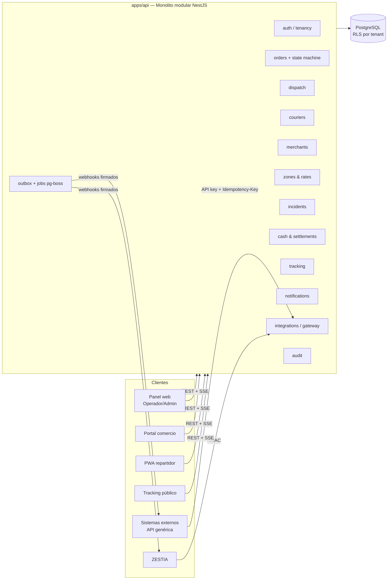

# Arquitectura

> Estado: **Aprobada** (ADR 001–012, 2026-11-17). Hosting pendiente (ADR-013). Decisiones en [`DECISIONS.md`](DECISIONS.md).

## Vista general



## Estructura del monorepo (propuesta)

```
apps/
  api/            NestJS — un módulo por bounded context
  web/            React + Vite — áreas: /panel, /comercio, /repartidor (PWA), /t/:token
packages/
  contracts/      Esquemas Zod + tipos compartidos + OpenAPI (fuente única de contratos)
  domain/         Lógica pura: máquina de estados, cálculo de tarifas, cálculo de efectivo
  auth/           Matriz rol → permisos
  config/         ESLint, TSConfig, Prettier compartidos
infra/
  docker/         docker-compose (postgres, mailpit)
docs/
```

## Reglas de módulos

- Cada módulo expone un servicio público; **prohibido** importar repositorios/entidades de otro módulo (regla de lint `eslint-plugin-boundaries`).
- La comunicación entre módulos que no requiera respuesta síncrona pasa por eventos de dominio (outbox).
- La lógica de negocio pura vive en `packages/domain` y se testea sin DB.

## Multi-tenancy

1. El `tenantId` se resuelve en el servidor desde la sesión (membresía activa) o desde la API key.
2. Un interceptor abre la transacción y ejecuta `SET LOCAL app.tenant_id = …`.
3. Políticas RLS en todas las tablas de negocio: `tenant_id = current_setting('app.tenant_id')::uuid`.
4. El usuario de DB de la aplicación **no** es owner ni tiene `BYPASSRLS`.
5. Tests de aislamiento automáticos para cada endpoint nuevo (helper `expectTenantIsolation`).

### Implementación (issue #15)

**Roles de base de datos** (`infra/docker/postgres/initdb/01-roles.sh`, mismo script en dev y en tests):

| Rol | Uso | Atributos |
|-----|-----|-----------|
| `POSTGRES_USER` (`zestia_admin`) | Bootstrap del contenedor | Superusuario. Ni la API ni las migraciones lo usan. |
| `zestia_migrator` | Migraciones (`MIGRATION_DATABASE_URL`, solo CLI de Prisma) | Dueño de la base y del esquema `public`. Sin `SUPERUSER`/`BYPASSRLS`. `CREATEDB` solo para la shadow DB de `prisma migrate dev`. |
| `zestia_app` | La API (`DATABASE_URL`) | No es dueño de nada, sin `SUPERUSER`/`BYPASSRLS`/`CREATEDB`/`CREATEROLE`. Solo los `GRANT` explícitos de cada migración. |

La API **no arranca** si `DATABASE_URL` usa un rol superusuario, con `BYPASSRLS` o dueño de tablas, y `/health/ready` responde 503 en ese caso.

**Políticas** (migración `*_tenancy_rls`): toda tabla accesible por `zestia_app` tiene RLS `ENABLE` + `FORCE`. Las políticas usan `app_current_tenant_id()` = `NULLIF(current_setting('app.tenant_id', true), '')::uuid` en `USING` y `WITH CHECK`: sin valor (o con el valor vacío que queda en la sesión después de un `SET LOCAL`) devuelven **cero filas, sin error**; un valor que no es UUID da error, nunca filas.

| Tabla | Política |
|-------|----------|
| `merchants` (y toda tabla de negocio futura) | `tenant_id = app_current_tenant_id()` (lectura y escritura) |
| `memberships` | Igual + lectura de las membresías propias (`app.user_id`) **solo sin tenant activo** (resolución del tenant) |
| `tenants` | El tenant activo; sin tenant activo, los tenants donde el usuario tiene membresía. Solo lectura. |
| `users` (global, PII) | El propio usuario y los miembros del tenant activo. Solo lectura. |

**Flujo de una request** (`apps/api/src/modules/tenancy`):

1. `@TenantScoped({ roles? })` en el controller aplica `TenantGuard` + `TenantTransactionInterceptor`.
2. `TenantGuard` pide el `Principal` (`{ userId, activeTenantId }`) al provider `PRINCIPAL_RESOLVER` (sin principal → 401), y `TenantResolver` busca la membresía en la DB con solo `app.user_id` fijado (sin membresía activa en un tenant `ACTIVE` → 403). `activeTenantId` es una preferencia de la sesión; si es `null` y hay una sola membresía, se usa esa. Cabeceras, query y body con `tenantId` se ignoran.
3. `TenantTransactionInterceptor` corre el handler dentro de `TenantDb.run(ctx, …)`: una transacción interactiva de Prisma que ejecuta `SELECT set_config('app.tenant_id', $1, true), set_config('app.user_id', $2, true)` (equivalente parametrizado de `SET LOCAL`).
4. Los repositorios inyectan `TenantDb` y usan `db.tx` (cliente de esa transacción) y filtran también por `db.context.tenantId`. Fuera de un contexto de tenant, `db.tx` lanza `TenantContextMissingError`.

**Cómo se impide saltearse el wrapper:**

- ESLint (`packages/config/eslint/tenancy.mjs`): solo `database/`, `health/` y `modules/tenancy/` pueden importar `PrismaService` o valores del cliente generado (los tipos sí); solo `modules/tenancy/` puede mencionar `app.tenant_id`, `app.user_id`, `set_config` o `row_security`.
- `TenantTx` no expone `$queryRawUnsafe`/`$executeRawUnsafe`.
- Un test recorre todas las rutas y exige `@TenantScoped()` o `@TenantExempt(motivo)` en cada una.
- Y si algo se escapa igual, la DB es fail-closed: una query sin contexto ve cero filas.

**Jobs/workers:** `TenantDb.run(context, fn)` con un contexto construido por el servidor (p. ej. el `tenant_id` de la fila del outbox), nunca con datos del cliente. No se permiten transacciones de tenant anidadas.

**Autenticación (#14):** debe registrar su implementación de `PrincipalResolver` en el token `PRINCIPAL_RESOLVER` (hoy `UnauthenticatedPrincipalResolver`: todo 401) y guardar `activeTenantId` en la sesión del servidor. Login por email, alta de usuarios y el selector de empresa necesitan su propio camino de datos: `users` tiene RLS (p. ej. una función `SECURITY DEFINER` acotada para buscar credenciales por email). La matriz rol → permisos de `packages/auth` reemplaza la opción `roles` de `@TenantScoped()`.

## Tiempo real

SSE por tenant y canal (`/api/v1/stream?channels=dispatch`). Los eventos salen del outbox → bus en memoria → conexiones SSE. Con más de una instancia: `LISTEN/NOTIFY` de Postgres. El cliente reconecta con `Last-Event-ID` y muestra estado "desconectado".

## Jobs y outbox

- `OutboxEvent` se escribe en la misma transacción que el cambio de negocio.
- Un worker (pg-boss) publica eventos: SSE, webhooks, notificaciones.
- Webhooks: backoff exponencial con jitter (1m, 5m, 15m, 1h, 6h), luego `DEAD`; reprocesamiento manual auditado.

## Observabilidad

Logs JSON (pino) con `correlationId`, `tenantId`, sin PII ni secretos (redacción automática). Healthchecks `/health/live` y `/health/ready`. Errores a Sentry (o equivalente) — [decisión pendiente].
