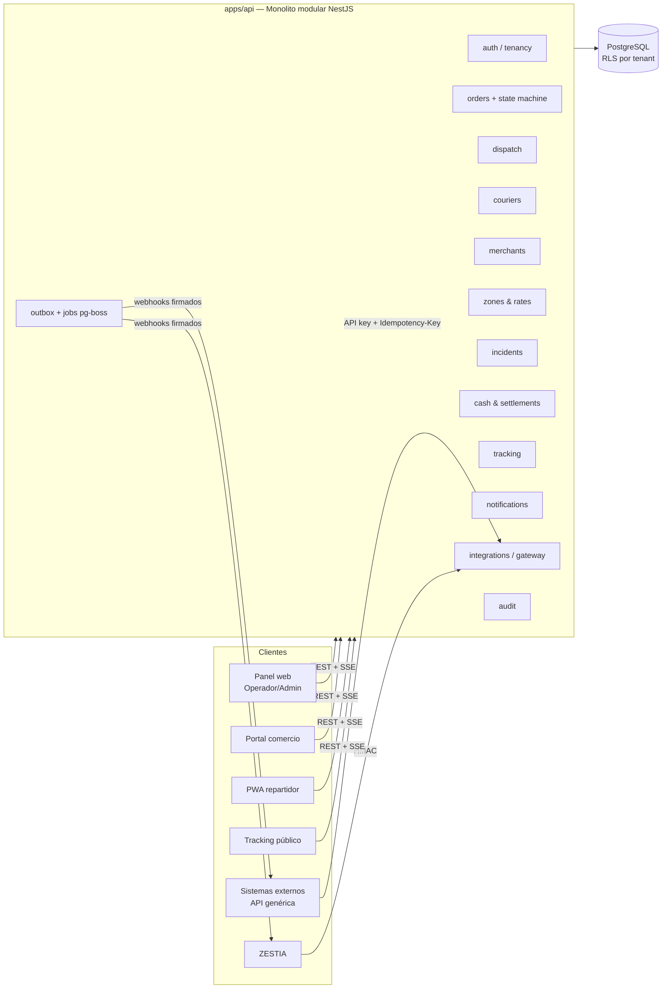

# Arquitectura

> Estado: **Propuesta** — pendiente de aprobación (issue de decisión de stack). Decisiones en [`DECISIONS.md`](DECISIONS.md).

## Vista general



## Estructura del monorepo (propuesta)

```
apps/
  api/            NestJS — un módulo por bounded context
  web/            React + Vite — áreas: /panel, /comercio, /repartidor (PWA), /t/:token
packages/
  contracts/      Esquemas Zod + tipos compartidos + OpenAPI (fuente única de contratos)
  domain/         Lógica pura: máquina de estados, cálculo de tarifas, cálculo de efectivo
  auth/           Matriz rol → permisos
  config/         ESLint, TSConfig, Prettier compartidos
infra/
  docker/         docker-compose (postgres, mailpit)
docs/
```

## Reglas de módulos

- Cada módulo expone un servicio público; **prohibido** importar repositorios/entidades de otro módulo (regla de lint `eslint-plugin-boundaries`).
- La comunicación entre módulos que no requiera respuesta síncrona pasa por eventos de dominio (outbox).
- La lógica de negocio pura vive en `packages/domain` y se testea sin DB.

## Multi-tenancy

1. El `tenantId` se resuelve en el servidor desde la sesión (membresía activa) o desde la API key.
2. Un interceptor abre la transacción y ejecuta `SET LOCAL app.tenant_id = …`.
3. Políticas RLS en todas las tablas de negocio: `tenant_id = current_setting('app.tenant_id')::uuid`.
4. El usuario de DB de la aplicación **no** es owner ni tiene `BYPASSRLS`.
5. Tests de aislamiento automáticos para cada endpoint nuevo (helper `expectTenantIsolation`).

## Tiempo real

SSE por tenant y canal (`/api/v1/stream?channels=dispatch`). Los eventos salen del outbox → bus en memoria → conexiones SSE. Con más de una instancia: `LISTEN/NOTIFY` de Postgres. El cliente reconecta con `Last-Event-ID` y muestra estado "desconectado".

## Jobs y outbox

- `OutboxEvent` se escribe en la misma transacción que el cambio de negocio.
- Un worker (pg-boss) publica eventos: SSE, webhooks, notificaciones.
- Webhooks: backoff exponencial con jitter (1m, 5m, 15m, 1h, 6h), luego `DEAD`; reprocesamiento manual auditado.

## Observabilidad

Logs JSON (pino) con `correlationId`, `tenantId`, sin PII ni secretos (redacción automática). Healthchecks `/health/live` y `/health/ready`. Errores a Sentry (o equivalente) — [decisión pendiente].
