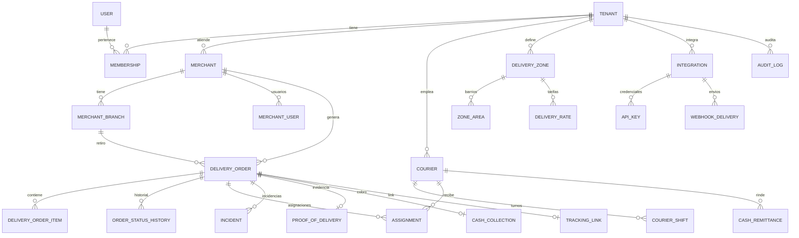

# Modelo de datos

> Estado: **Conceptual** — se convierte en esquema Prisma en R1/R2. Convenciones al final.
> Implementado (issue #15, `apps/api/prisma/schema.prisma`): `Tenant`, `User` (sin credenciales aún), `Membership` (sin `courierId`/`merchantId` aún) y `Merchant` (mínimo, CRUD en #19), con RLS.

## Entidades principales

| Entidad | Campos clave | Notas |
|---------|--------------|-------|
| `Tenant` | id, name, slug, timezone (`America/Asuncion`), currency (`PYG`), settings (SLA, auto-aceptar, evidencia requerida), status | |
| `User` | id, email (único), name, phone, passwordHash, twoFactorSecret?, status | Global, sin tenantId |
| `Membership` | userId, tenantId, role (enum), courierId?, merchantId? | Une usuario ↔ tenant ↔ rol |
| `Merchant` | tenantId, name, ruc?, phone, status (`ACTIVE`/`SUSPENDED`/`ARCHIVED`) | |
| `MerchantBranch` | tenantId, merchantId, name, address, neighborhood, city, references, lat?, lng?, openingHours (JSON) | |
| `Courier` | tenantId, userId?, name, phone, vehicleType, capacity, availability, status | |
| `DeliveryZone` / `ZoneArea` | tenantId, name / zoneId, city, neighborhood | Único `(tenantId, city, neighborhood)` |
| `DeliveryRate` | tenantId, zoneId, merchantId?, amount (BIGINT), validFrom, validTo? | Override por comercio |
| `DeliveryOrder` | tenantId, code (legible, único por tenant), externalId?, source, merchantId, branchId, recipient*, address*, status, paymentMethod, amountToCollect, deliveryFee, feePaidBy, collectionStatus, hasOpenIncident, version, timestamps por etapa, deletedAt? | Único `(tenantId, source, externalId)` |
| `OrderStatusHistory` | tenantId, orderId, from, to, actorType, actorId, reason?, clientAt?, serverAt, correlationId | Append-only |
| `Assignment` | tenantId, orderId, courierId, assignedBy, assignedAt, acceptedAt?, rejectedAt?, endedAt?, reason? | |
| `Incident` / `IncidentCategory` | tenantId, orderId, categoryId, reportedBy, description, evidenceUrl?, status, resolution?, resolvedBy?, resolvedAt? | |
| `ProofOfDelivery` | tenantId, orderId, receiverName?, photoKey?, code? | Archivos en object storage |
| `CashCollection` | tenantId, orderId, courierId, expected, collected, method, collectedAt | |
| `CashRemittance` | tenantId, courierId, date, amount, receivedBy, difference, notes | |
| `Settlement` / `SettlementLine` | tenantId, party (merchant/courier), period, status, totals / concepto, monto | R5 |
| `Integration` / `ApiKey` | tenantId, type (`GENERIC`/`ZESTIA`), webhookUrl, webhookSecretRef / prefix, hash, lastUsedAt, revokedAt | Secreto nunca en claro |
| `IdempotencyRecord` | tenantId, integrationId, key, requestHash, responseSnapshot, expiresAt | Único `(integrationId, key)` |
| `OutboxEvent` / `WebhookDelivery` | tenantId, type, payload, status / eventId, attempt, status, nextAttemptAt, lastError | |
| `TrackingLink` | tenantId, orderId, tokenHash, expiresAt | |
| `AuditLog` | tenantId, actorType, actorId, action, entity, entityId, before, after, ip, correlationId, at | Append-only |

## Convenciones

- PK `uuid` (v7 para orden temporal). Código legible de pedido por tenant (p. ej. `ZD-000123`).
- Toda tabla de negocio: `tenant_id NOT NULL`, índice compuesto con `tenant_id` primero, política RLS.
- Montos: `BIGINT` en unidad mínima. Nunca `float`/`decimal` para PYG.
- Fechas: `timestamptz` en UTC.
- Borrado lógico (`deletedAt`) en comercios, sucursales, repartidores, zonas; historial y auditoría son append-only.
- PII del destinatario minimizada y anonimizable por política de retención.
