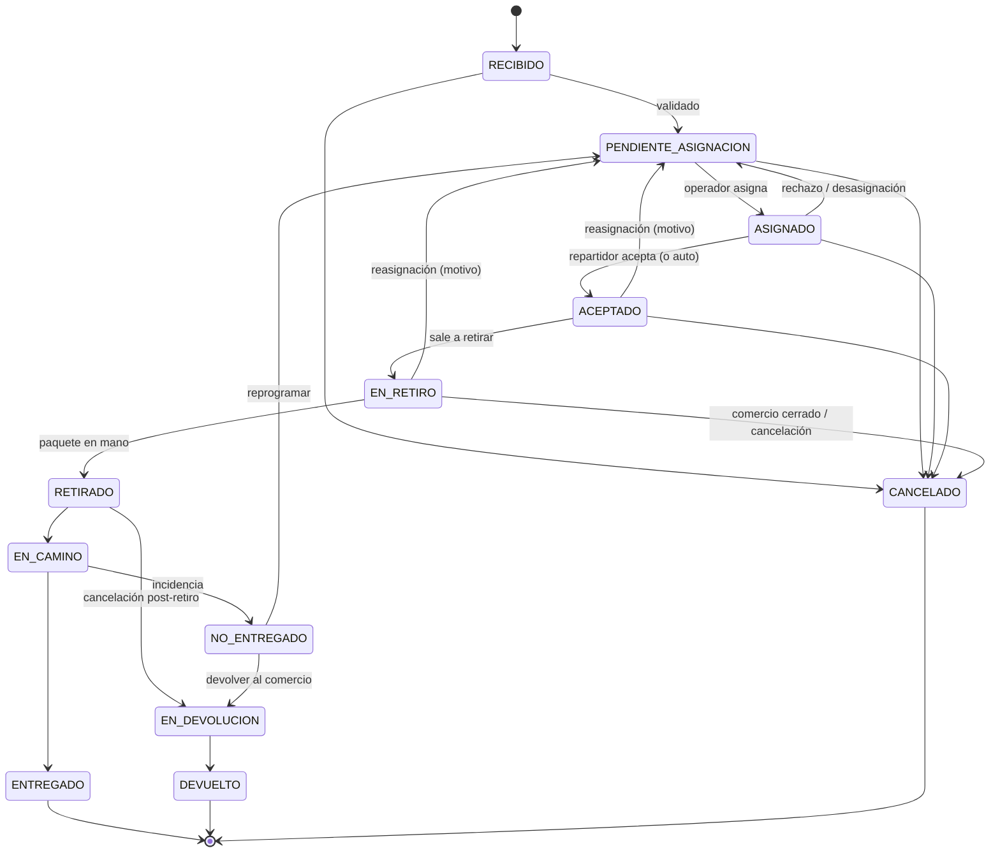

# Máquina de estados del pedido

> Estado: **Propuesta v2** — [VALIDAR] con despachadores y repartidores en R0.

## Tabla de transiciones

| Desde | Hacia | Quién | Requisitos |
|-------|-------|-------|------------|
| RECIBIDO | PENDIENTE_ASIGNACION | Sistema / Operador | Datos válidos, zona resuelta |
| RECIBIDO, PENDIENTE_ASIGNACION, ASIGNADO, ACEPTADO, EN_RETIRO | CANCELADO | Operador, Supervisor, Comercio (solo antes de ASIGNADO), API | Motivo obligatorio |
| PENDIENTE_ASIGNACION | ASIGNADO | Operador | Repartidor activo y `DISPONIBLE`/`OCUPADO` |
| ASIGNADO | ACEPTADO | Repartidor asignado / Sistema (auto-aceptar) | — |
| ASIGNADO | PENDIENTE_ASIGNACION | Repartidor (rechazo) / Operador | Motivo de rechazo |
| ACEPTADO, EN_RETIRO | PENDIENTE_ASIGNACION | Operador | **Motivo obligatorio** |
| ACEPTADO | EN_RETIRO | Repartidor asignado | — |
| EN_RETIRO | RETIRADO | Repartidor asignado | — |
| RETIRADO | EN_CAMINO | Repartidor asignado | — |
| RETIRADO | EN_DEVOLUCION | Operador | Motivo |
| EN_CAMINO | ENTREGADO | Repartidor asignado | Evidencia si el tenant la exige; cobro registrado si `EFECTIVO` |
| EN_CAMINO | NO_ENTREGADO | Repartidor asignado | Incidencia obligatoria |
| NO_ENTREGADO | PENDIENTE_ASIGNACION | Operador / Supervisor | Nueva ventana horaria opcional |
| NO_ENTREGADO | EN_DEVOLUCION | Operador / Supervisor | — |
| EN_DEVOLUCION | DEVUELTO | Repartidor / Operador | Confirmación del comercio [VALIDAR] |

Toda otra transición → **HTTP 409** `INVALID_TRANSITION`.

## Reglas

- Las transiciones se implementan en un único servicio de dominio (`OrderStateMachine`) con tabla declarativa; ningún controlador modifica `status` directamente.
- Cada transición crea `OrderStatusHistory` (from, to, actor, motivo, `clientTimestamp`, `serverTimestamp`, `correlationId`) y un `OutboxEvent`, **en la misma transacción**.
- Bloqueo optimista (`version`) para evitar carreras entre panel y repartidor.
- Cambios offline del repartidor: se aplican en orden de `clientTimestamp`; si la transición ya no es válida (p. ej. pedido reasignado), se rechaza y se notifica al dispositivo.
- **Incidencias** no son estados: `hasOpenIncident` se calcula/actualiza al abrir/cerrar incidencias.
- **Estado de cobro** separado: `NO_APLICA → PENDIENTE → COBRADO → RENDIDO → LIQUIDADO`.
