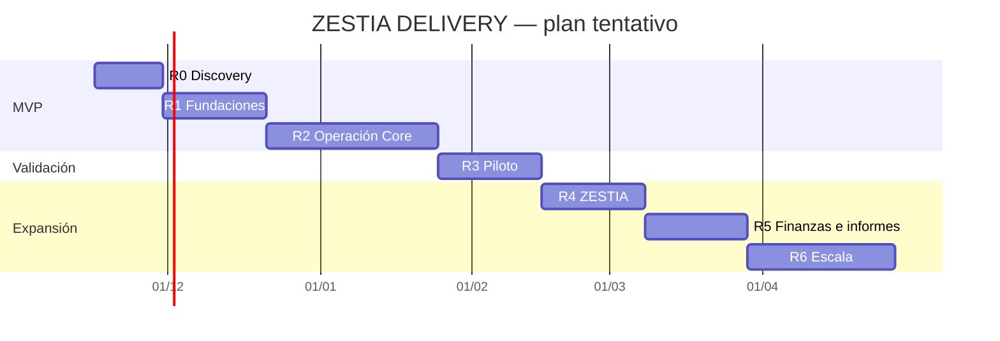

# Roadmap

> Supuesto de capacidad: **2 devs full-stack + 1 PM/PO parcial**, sprints de **1 semana** en R0–R3 (feedback rápido) y de 2 semanas después. Recalcular cuando se confirme el equipo (issue de decisión).
> Cada release tiene un **milestone** en GitHub con sus issues.

*Fechas tentativas; las fiestas de fin de año pueden correr R1–R2 ~1–2 semanas.*

## R0 — Discovery (2 semanas)

**Objetivo:** reducir incertidumbre antes de escribir código de producto.
- Entrevistar 5–8 empresas de delivery (guía en [`DISCOVERY.md`](DISCOVERY.md)).
- Validar estados, roles, flujo de efectivo, evidencia de entrega, disposición a pagar.
- Comprometer **empresa piloto**.
- Auditar ZESTIA (checklist en [`ZESTIA_INTEGRATION.md`](ZESTIA_INTEGRATION.md)).
- Aprobar ADRs 002–012, decidir hosting (ADR-013).
- Wireframes de despacho y PWA repartidor; test con 2 despachadores.
- Consulta legal: datos personales, términos y privacidad.

**Salida (gate):** informe de discovery + ADRs aprobados + piloto confirmado. Sin piloto → re-evaluar.

## R1 — Fundaciones (3 semanas)

- Monorepo, lint, formato, CI (lint/typecheck/test), Docker Compose, seeds.
- Auth (email + contraseña, sesiones seguras, reset de contraseña), membresías, cambio de tenant.
- Multi-tenancy con RLS + suite de tests de aislamiento.
- Roles fijos y guardas de permisos.
- Auditoría (`AuditLog`) transversal.
- CRUD comercios y sucursales; usuarios del tenant e invitaciones.
- Base de UI: layout, design tokens, tabla, formularios, estados vacíos/error/carga.

**Gate:** 2 tenants aislados en entorno de staging, tests de aislamiento en verde.

> **Desvío (2026-11-25):** sin staging (ADR-013 pospuesto), el gate se valida en local con Docker Compose: 2 empresas del seed aisladas por RLS y la suite de aislamiento en verde. Se revalida en los servidores propios antes de producción.

## R2 — Operación Core / MVP (5 semanas)

- Zonas por barrio + tarifas + simulador.
- Pedidos: alta manual, portal comercio, API genérica + idempotencia + API keys.
- Máquina de estados + historial + outbox.
- Despacho kanban + asignación/reasignación + SSE + alertas de demora.
- Repartidores + PWA (offline queue) + aceptación/rechazo.
- Incidencias.
- Rendición de efectivo.
- Tracking público con token.
- Webhooks salientes con reintentos + panel de estado.
- Dashboard operativo + export CSV.

**Gate:** criterios de aceptación MVP ([`SPEC.md` §14](SPEC.md)) verificados.

## R3 — Piloto (3 semanas)

Operación real en paralelo al proceso actual → luego reemplazo. Soporte diario, hotfixes, medición de KPIs. **Go/No-go** con datos.

## R4 — ZESTIA (3 semanas) · R5 — Finanzas e informes (3 semanas) · R6 — Escala (continuo)

Ver [`SPEC.md` §13](SPEC.md) y el [análisis PM](00_ANALISIS_PM.md#4-propuesta-de-alcance-releases-en-lugar-de-fases-abiertas).
